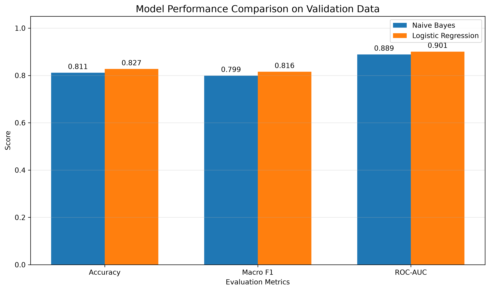
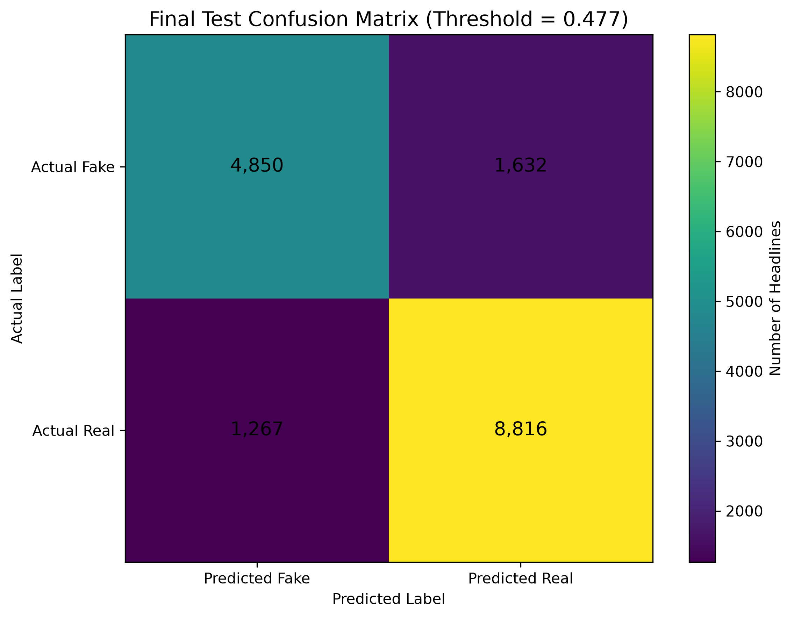
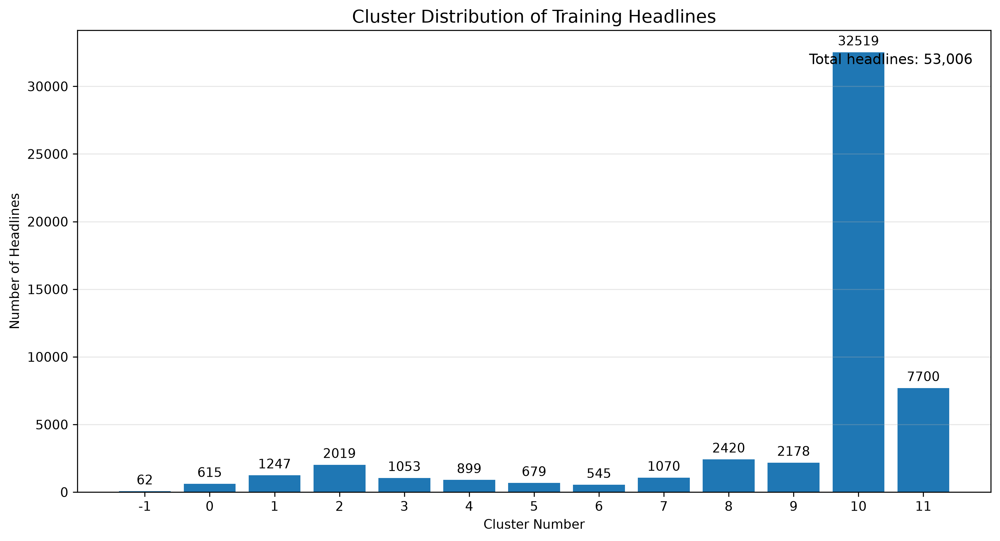

# 📰 Fake News Headline Detector


A machine learning project that analyzes news headlines and classifies them as **Fake**, **Real**, or **Insufficient Evidence**. It compares **Naive Bayes** and **Logistic Regression** on **TF-IDF** features, explains predictions through influential words, and uses **K-means clustering** to explore headline topics. Everything is wrapped in an interactive **Streamlit** web app.

---

## 📑 Table of Contents

- [Screenshots](#-screenshots)
- [Features](#-features)
- [Technologies Used](#-technologies-used)
- [Dataset](#-dataset)
- [Machine Learning Approach](#-machine-learning-approach)
- [Object-Oriented Design](#-object-oriented-design)
- [Streamlit Application](#-streamlit-application)
- [Installation](#-installation)
- [Project Structure](#-project-structure)
- [Documentation and Visualizations](#-documentation-and-visualizations)
- [Limitations](#-limitations)
- [Authors](#-authors)
- [License](#-license)

---

## 🖼️ Screenshots

### 1. Analyze Headline


*Enter a headline to see the prediction, confidence score, influential words, and any warnings.*

### 2. Prediction Explanation (Influential Words)


*Words that pushed the model toward Fake or Real.*

### 3. Spelling Advisory


*Possible spelling issues are flagged as advice only; the user's input is never changed automatically.*

### 4. Explore News Topics


*Browse K-means topic clusters and their summaries.*

### 5. About Project


*Project information, model details, and limitations at a glance.*

### 6. Evaluation Charts

| Model Comparison (Validation) | Final Test Confusion Matrix | Cluster Distribution |
|:---:|:---:|:---:|
|  |  |  |

---

## ✨ Features

- Classifies headlines as **Fake**, **Real**, or **Insufficient Evidence**
- Converts text to numerical features with **TF-IDF**
- Compares **Naive Bayes** and **Logistic Regression** classifiers
- Uses a selected **Logistic Regression** model for final predictions
- Provides **confidence scores** and **influential-word explanations**
- Detects possible spelling issues and gives advisory suggestions without modifying user input
- Uses **K-means clustering** to explore news topics
- Includes an interactive **Streamlit** web application
- Demonstrates **OOP**: inheritance, encapsulation, and method overriding

---

## 🛠️ Technologies Used

| Category | Tools |
|---|---|
| Language | Python |
| Data | Pandas, NumPy, SciPy |
| Machine Learning | Scikit-learn, Joblib |
| Visualization | Matplotlib |
| Web App | Streamlit |
| Techniques | TF-IDF, Naive Bayes, Logistic Regression, K-means Clustering |

---

## 📊 Dataset

The project uses the cleaned dataset:

```
data/processed/final_headlines_cleaned_v2.csv
```

It contains **82,823 headlines**, divided as follows:

| Split | Number of Headlines |
|---|---:|
| Training | 53,006 |
| Validation | 13,252 |
| Testing | 16,565 |
| **Total** | **82,823** |

The training split is used for model training, the validation split for model comparison and selection, and the held-out test split for final evaluation.

---

## 🧠 Machine Learning Approach

### 1. Text Representation
**TF-IDF** (Term Frequency–Inverse Document Frequency) converts headlines into numerical feature vectors. The final classification pipeline uses **10,000 TF-IDF features**.

### 2. Classification Models
Two algorithms were compared:

- Multinomial **Naive Bayes**
- **Logistic Regression** *(selected as the final model)*

The final model uses a classification threshold of **0.477**.

### 3. Model Evaluation
The selected model was evaluated on the held-out test set:

| Metric | Test Result |
|---|---:|
| Macro F1-score | **0.8144** |
| ROC-AUC | **0.8972** |

The test set was kept separate from model selection and threshold tuning.

### 4. Topic Clustering
**K-means** groups headlines by their text features. The app uses previously generated clustering results to display topic summaries and explore headline groups.

---

## 🧩 Object-Oriented Design

| Class | Role |
|---|---|
| `HeadlineEnvironment` | Handles headline input and validation |
| `TextClassifier` | Parent class with shared classification functionality |
| `NaiveBayesAgent` | Inherits from `TextClassifier`; implements Naive Bayes prediction |
| `LogisticRegressionAgent` | Inherits from `TextClassifier`; implements Logistic Regression prediction |

The implementation demonstrates **encapsulation**, **inheritance**, **method overriding**, and **code reuse**.

---

## 🖥️ Streamlit Application

| Section | Description |
|---|---|
| **Analyze Headline** | Enter a headline and view its prediction, confidence, influential words, and warnings |
| **Explore News Topics** | Explore existing K-means clusters and their summaries |
| **About Project** | View project information, model details, and limitations |

---

## 🚀 Installation

### 1. Clone the Repository

```bash
git clone https://github.com/mhassan1123/Fake-News-Headline-Detector
cd Fake-News-Headline-Detector
```

### 2. Create a Virtual Environment

```bash
python -m venv venv
```

Activate it:

```powershell
# Windows PowerShell
.\venv\Scripts\Activate.ps1
```

### 3. Install Dependencies

```bash
python -m pip install --upgrade pip
pip install -r requirements.txt
```

### 4. Run the Application

From the project root directory:

```bash
python -m streamlit run app.py
```

Streamlit prints a local URL in the terminal (usually `http://localhost:8501`). Open it in your browser.

---

## 📁 Project Structure

```
Fake-News-Headline-Detector/
│
├── app.py
├── requirements.txt
├── README.md
├── generate_charts.py
│
├── data/
│   ├── processed/
│   │   └── final_headlines_cleaned_v2.csv
│   └── splits_cleaned_v2/
│
├── experiments/
│   ├── run_experiments.py
│   ├── train_naive_bayes.py
│   ├── train_logistic_regression.py
│   ├── finalize_model_selection.py
│   └── evaluate_final_model.py
│
├── outputs/
│   └── cleaned_v2/
│       ├── models/
│       ├── clustering/
│       ├── reproducible_experiment/
│       └── audits/
│
├── src/
│   ├── agents.py
│   ├── inference.py
│   ├── explain.py
│   ├── clustering.py
│   ├── data_loader.py
│   └── preprocessing.py
│
└── docs/
    ├── agent_design.md
    ├── learning_agent_architecture.md
    ├── class_diagram.md
    ├── dataset_schema.md
    └── charts/
```

> ⚠️ The app depends on the saved model and vectorizer artifacts in `outputs/cleaned_v2/`. Keep these files and their directory structure intact.

---

## 📚 Documentation and Visualizations

Additional documentation is in the `docs/` directory:

- [PEAS and Task Environment Classification](docs/agent_design.md)
- [Learning Agent Architecture](docs/learning_agent_architecture.md)
- [UML Class Diagram and OOP Concepts](docs/class_diagram.md)
- [Dataset Schema](docs/dataset_schema.md)

Generated evaluation charts are in `docs/charts/`:

- `model_comparison_validation.png`
- `final_test_confusion_matrix.png`
- `cluster_distribution.png`

---

## ⚠️ Limitations

- The system analyzes **headline text only**, not the full article.
- Predictions reflect patterns learned from the training dataset.
- Model confidence is **not** factual certainty.
- Misspellings, incomplete headlines, unfamiliar names, and out-of-vocabulary words may reduce reliability.
- Spelling suggestions are advisory and never modify the original headline.
- The app does not verify news sources or establish whether a claim is true.

> **Important:** This is an educational machine learning project, not a professional fact-checking service. Its predictions should not be treated as proof that a news story is true or false.

---

## 👥 Authors

- **Muhammad Hassan** – [GitHub](https://github.com/mhassan1123)
- **Bilal Ahmed Khan** – [GitHub](https://github.com/BilalAhmadk929)

---

## 📄 License

This project is licensed under the MIT License. See the `LICENSE` file for details.
