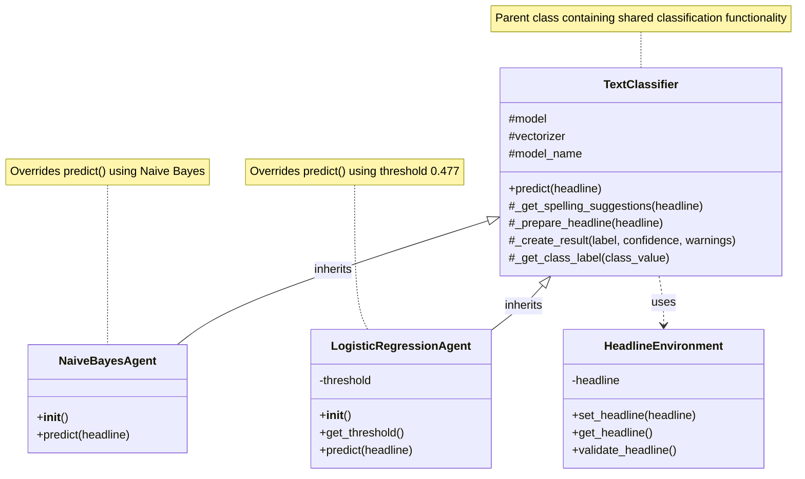

# UML Class Diagram

The following UML class diagram represents the object-oriented design of the Fake News Headline Detector.

## Object-Oriented Programming Concepts

### 1. Encapsulation

- `HeadlineEnvironment` uses `__headline` to keep the headline attribute private.
- `LogisticRegressionAgent` uses `__threshold` to keep the decision threshold private.
- `TextClassifier` stores shared model and vectorizer attributes.

### 2. Inheritance

`NaiveBayesAgent` and `LogisticRegressionAgent` inherit from the `TextClassifier` parent class.

This allows both child classes to reuse common functionality such as input preparation, spelling suggestions, and result creation.

### 3. Method Overriding

Both child classes override the `predict()` method.

- `NaiveBayesAgent` implements prediction using the Naive Bayes model.
- `LogisticRegressionAgent` implements prediction using the selected Logistic Regression model and its decision threshold.

### 4. Abstraction

The `TextClassifier` class provides common classification functionality. Child classes provide model-specific prediction behavior through their own implementations of `predict()`.

## Conclusion

The class structure demonstrates encapsulation, inheritance, method overriding, and code reuse. The design separates headline validation from model-specific classification.